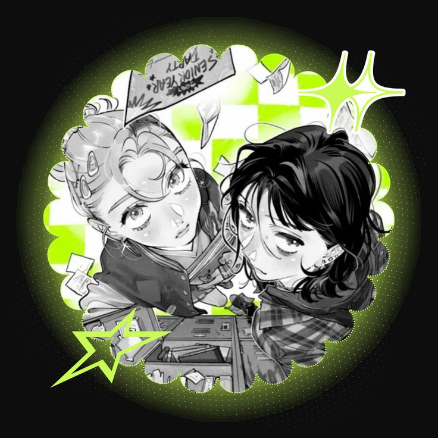
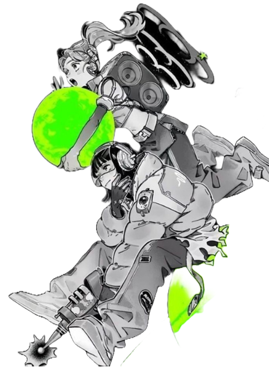

<div align="center">

  

  <h1>✦ OTÁVIO VIANNA ✦</h1>
  <p><strong>UI/UX DESIGNER • FULL-STACK ENGINEER • 3D & CREATIVE DEV</strong></p>

  <p>
    <a href="https://portfolio-otavio-psi.vercel.app">
      
    </a>
    <a href="https://www.linkedin.com/in/ot%C3%A1vio-vianna-lima-1b26a932a/">
      
    </a>
    <a href="mailto:otavioviannalima@gmail.com">
      
    </a>
  </p>

  <sub><i>"Acredito que o design não é apenas como algo se parece, mas como ele <b>ecoa</b> na experiência de quem o usa."</i></sub>

</div>

<br />

---

## 💿 SIDE A // A ESTÉTICA ("MANGA GREEN")

<table>
  <tr>
    <td width="65%" valign="top">
      <p>
        A direção visual deste portfólio é um tributo direto à identidade gráfica do mangá <strong><i>The Guy She Was Interested In Wasn't a Guy at All</i></strong> (気になっている人が男じゃなかった), de <strong>Sumiko Arai</strong> — conhecido pela comunidade como <i>"The Green Yuri"</i>.
      </p>
      <p>
        Assim como nas páginas de Mitsuki Koga e Aya Oosawa, o projeto mistura a energia crua das <strong>lojas de discos de rock alternativo</strong> com o minimalismo editorial moderno: contraste extremo em preto e branco cortado pelo <strong>Verde Ácido/Neon (<code>#B2F802</code>)</strong>, ondas sonoras procedurais reagindo em tempo real, um <strong>CD 3D interativo</strong> e tipografia limpa em <i>Space Grotesk</i>.
      </p>
      <ul>
        <li><strong><code>#B2F802</code> (Manga Green)</strong> — Destaque elétrico, interações, cursores e ondas de frequência.</li>
        <li><strong><code>#121212</code> (Vinyl Black)</strong> — Fundo profundo de alto contraste.</li>
        <li><strong><code>#FAFAFA</code> (Paper White)</strong> — Leitura editorial e respiro visual.</li>
      </ul>
    </td>
    <td width="35%" align="center" valign="middle">
      
    </td>
  </tr>
</table>

---

## 🎸 SIDE B // TRACKLIST (PROJETOS EM DESTAQUE)

Cada projeto do portfólio funciona como uma faixa do álbum — indo de sistemas corporativos e geoprocessamento até modelagem 3D e engenharia reversa:

| Track | Projeto | Contexto / Cliente | Stack Principal | Destaques Técnicos |
| :---: | :--- | :--- | :--- | :--- |
| **01** | **[Planejamento RF & BDGD](https://github.com/GeneSys-fatec/API-5DSM)** | GeneSys / Tecsys (5º Sem) | `Python` `Java Spring` `Flutter` `PostGIS` | Pipeline ETL geoespacial (BDGD/ANEEL) orquestrado via n8n + simulação matemática de cobertura de radiofrequência em mapa interativo. |
| **02** | **Orihime Inoue 3D Mod** | Pessoal (*skate.* / ReSkate) | `Blender 3D` `Python` `C#` `Three.js` | Re-rigging de 129 ossos (31.3k vértices), baking de texturas 2K, patch binário Oodle Kraken (`.fbmod`) e **Visualizador 3D interativo** no site. |
| **03** | **[Spider-Punk 2099 Mod](https://github.com/tuzzooz/mod-aranha-2099)** | Pessoal (*Spider-Man PC*) | `Blender 3D` `UV Mapping` `DirectXTex` `ALERT` | Re-rigging anatômico, remapeamento UV de shader emissivo para a viseira neon e atlas de texturas 4K (`4096×4096`) com correção sRGB. |
| **04** | **Dashboard Tecsus IoT** | Tecsus (4º Sem) | `Next.js` `TypeScript` `IoT` | Atuação como **Scrum Master** e dev Front-end em plataforma de telemetria em tempo real para eficiência hídrica e energética. |
| **05** | **Leitor de HQ & Mangás** | Pessoal | `React Native` `Expo` `Figma` | App mobile multiplataforma com scanner de ISBN via câmera, arquitetura offline-first e UI/UX autoral. |
| **06** | **[Ollama Music Bot](https://github.com/tuzzooz/ChatBot-Musica)** | Pessoal | `Python` `Ollama LLM` `Telegram API` | Bot assíncrono com IA local que processa linguagem natural e retorna letras e curiosidades musicais em `< 2s`. |
| **07** | **[Task Manager](https://github.com/the-devs-department/GSW-2025.2-3Sem)** | GSW (3º Sem) | `Java` `Spring Boot` `MongoDB` `JUnit` | Arquitetura de microsserviços sob alta concorrência com **90% de cobertura de testes** nas rotinas críticas. |
| **08** | **[Dashboard Empresas](https://github.com/the-devs-department/HELPNEI-2025.1-2Sem)** | Helpnei (2º Sem) | `React` `TypeScript` `Tailwind CSS` | Painel analítico B2B com refatoração completa de estado via Context API eliminando *prop drilling*. |
| **09** | **[Câmara Vereadores](https://github.com/tuzzooz/the-devs-department)** | API 1º Semestre | `Python` `Flask` `Web Scraping` | Extração automatizada de dados de PDFs públicos e dashboard de transparência de votações municipais. |

---

## 🎛️ ENGENHARIA & EXPERIÊNCIA INTERATIVA

O portfólio não é apenas uma vitrine estática — ele foi construído como um laboratório de **Creative Engineering**:

- **🌀 Visualizadores 3D WebGL (`React Three Fiber` & `Drei`)**:
  - **CD Case 3D (`/sobre`)**: Modelo `.glb` flutuante com iluminação de estúdio na página *Sobre Mim*.
  - **Orihime 3D Viewer (`/projetos/orihime-mod`)**: Cena 3D interativa com `OrbitControls`, `ContactShadows`, rotação 360° e inspeção em tempo real da malha de 41.553 triângulos usada no mod de *skate.*.
- **〰️ Onda Sonora Procedural (`HeroSection`)**: Curva SVG animada a 60fps via `useAnimationFrame` do Framer Motion utilizando modulação senoidal.
- **✍️ Guestbook em Tempo Real (`/guestbook`)**: Mural de visitas persistido no **Supabase (PostgreSQL)**, acompanhado da seção *"Durante Meu Tempo Livre"* (com faixas de *Nirvana*, *My Chemical Romance*, *Los Hermanos* e leituras atuais).
- **🎯 Cursor & Floating Previews (`WorkSection`)**: Preview flutuante com física de mola (`useSpring`) acompanhando o cursor sobre a lista de projetos.

---

## 🛠️ TECH STACK DO PORTFÓLIO

<div align="center">

  
  
  
  
  
  
  
  

</div>

---

## 📂 ESTRUTURA DO PROJETO

```text
portfolio-otavio/
├── public/
│   ├── cd_final_v1.glb          # Modelo 3D do CD (Página Sobre)
│   ├── orihime.glb              # Modelo 3D da Orihime Inoue (31k vértices)
│   ├── yuriverde.png            # Arte temática The Green Yuri (Guestbook)
│   ├── mitsuayaicon.jpg         # Ícone Mitsuki & Aya
│   └── projetos/                # Previews dos projetos
└── src/
    ├── components/
    │   ├── CDViewer.tsx         # Canvas 3D do CD interativo
    │   ├── OrihimeViewer.tsx    # Canvas 3D interativo do Mod da Orihime
    │   ├── HeroSection.tsx      # Hero com onda sonora SVG procedural
    │   ├── WorkSection.tsx      # Vitrine principal com preview em spring physics
    │   ├── Header.tsx           # Navegação minimalista responsiva
    │   └── Footer.tsx           # Rodapé e links rápidos
    ├── pages/
    │   ├── Home.tsx             # Landing page
    │   ├── Projects.tsx         # Catálogo de projetos (List View & Grid View)
    │   ├── ProjectDetails.tsx   # Case study de cada projeto + 3D Viewer
    │   ├── About.tsx            # Trajetória, bio, skills e CD 3D
    │   ├── Guestbook.tsx        # Livro de visitas (Supabase) + On Repeat
    │   └── Contact.tsx          # Canais diretos de contato
    └── services/
        └── supabase.ts          # Cliente Supabase com fallback local seguro
```

---

## ⚡ COMO RODAR LOCALMENTE

```bash
# 1. Clone o repositório
git clone https://github.com/tuzzooz/portfolio-otavio.git
cd portfolio-otavio

# 2. Instale as dependências
npm install

# 3. (Opcional) Configure as variáveis do Guestbook em um arquivo .env
# VITE_SUPABASE_URL=sua_url_do_supabase
# VITE_SUPABASE_ANON_KEY=sua_chave_anon

# 4. Inicie o servidor de desenvolvimento
npm run dev
```

Acesse `http://localhost:5173` no navegador.

---

<div align="center">
  <p>
    <sub>Desenvolvido com música alta, café e <code>#B2F802</code> por <strong>Otávio Vianna Lima</strong> • São José dos Campos, SP</sub>
  </p>
</div>
